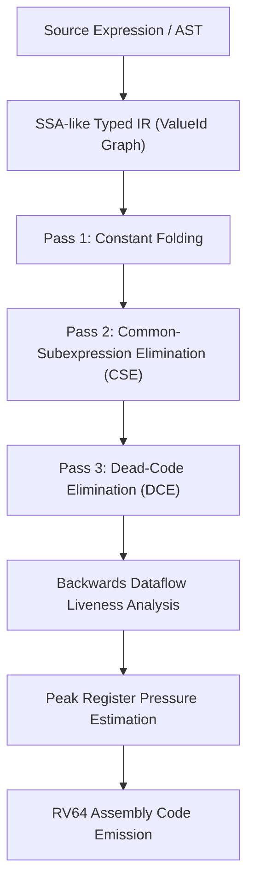

# OptiForge

[](https://github.com/Shivampal157/OptiForge-/actions/workflows/build.yml)
[](https://en.cppreference.com/w/cpp/17)
[-red.svg)](https://riscv.org/)
[](LICENSE)

An original, end-to-end **C++17 compiler optimization research prototype** designed to explore the foundational algorithms powering production CPU compiler backends: typed intermediate representation (IR), constant folding, local common-subexpression elimination (CSE), dead-code elimination (DCE), backwards dataflow liveness analysis, peak register pressure estimation, and RISC-V (RV64) machine code emission.

---

## Architecture Overview



---

## Core Compiler Passes & Modules

### 1. Typed Intermediate Representation (`optiforge::IR`)
* Value-based SSA-like graph representation where each instruction produces a unique, immutable `ValueId`.
* Explicit operation codes: `Constant`, `Add`, `Sub`, `Mul`, `Load`, `Store`, `Return`.
* Clean, human-readable IR formatting via `Function::dump()`.

### 2. Multi-Pass Optimization Pipeline (`optiforge::Optimizer`)
* **Constant Folding**: Evaluates constant arithmetic at compile-time when operands are known literals.
* **Local Common-Subexpression Elimination (CSE)**: Identifies identical pure arithmetic expressions (`Add`, `Sub`, `Mul`) within a function and reuses the existing `ValueId`, eliminating redundant instructions.
* **Dead-Code Elimination (DCE)**: Traverses use-def chains to recursively prune unused, side-effect-free values.

### 3. Backwards Dataflow Liveness & Register Pressure (`optiforge::Analysis`)
* Evaluates instruction live ranges in reverse topological order.
* Tracks exact consumer use counts for every value.
* Computes **Peak Live Values** to quantify register pressure and model spill risk before physical register allocation.

### 4. Educational RV64 Machine Code Emitter (`optiforge::riscv_emitter`)
* Translates optimized IR values into valid RISC-V (RV64) assembly instructions (`ld`, `li`, `add`, `sub`, `mul`, `mv`, `ret`).
* Maps value lifetimes into standard RISC-V caller/callee-saved registers (`x5` through `x16`, `a0`).

---

## Benchmark Results

Running `optiforge-benchmark` against deterministic arithmetic kernels:

| Benchmark Kernel | IR Instructions Before | IR Instructions After | Instruction Reduction | Peak Live Values (Registers) |
| :--- | :---: | :---: | :---: | :---: |
| **Polynomial Evaluation ($3x^3 + 7x^2 + 11x + 4$)** | 15 | 13 | **13.3%** | 6 |
| **Common-Subexpression & Redundant Arithmetic** | 9 | 7 | **22.2%** | 3 |

---

## Interactive Browser Visualizer

OptiForge includes an offline, zero-dependency browser visualizer located at [`web/index.html`](web/index.html). It simulates IR transformations, displays before/after IR comparisons, models register pressure gauges, and renders generated RV64 assembly.

To view locally:
```bash
open web/index.html    # macOS
start web/index.html   # Windows
```

---

## Building and Running

OptiForge builds natively with any C++17 compliant compiler (GCC 9+, Clang 10+, MSVC 2019+).

```bash
# 1. Configure CMake
cmake -S . -B build

# 2. Build library, CLI, benchmarks, and test suite
cmake --build build --config Release

# 3. Execute unit tests
ctest --test-dir build -C Release --output-on-failure

# 4. Run CLI demonstration
./build/optiforge-cli          # Linux/macOS
.\build\Release\optiforge-cli  # Windows

# 5. Run benchmarks
./build/optiforge-benchmark          # Linux/macOS
.\build\Release\optiforge-benchmark  # Windows
```

---

## Compiler Engineering Discussion Guide

### 1. Why is CSE safe for pure arithmetic but not automatically safe for loads and stores?
Pure arithmetic instructions (`add`, `mul`) are referentially transparent: identical inputs always yield identical outputs without side effects. In contrast, loads and stores interact with the memory hierarchy. A load cannot be eliminated if an intervening store may alias the same memory address. Safe memory CSE requires pointer alias analysis and memory dependency graphs.

### 2. How does common-subexpression elimination impact register pressure?
While CSE eliminates redundant instructions, it lengthens the **live range** of the reused value. A value computed earlier must now remain live until its latest use across the program. If too many live ranges overlap, peak register pressure exceeds physical register file capacity (e.g., 32 integer registers in RISC-V), forcing the register allocator to spill values to the stack.

### 3. Why must dead-code elimination (DCE) track use-def chains?
A compiler cannot simply delete an unused instruction in isolation; removing an unused instruction eliminates its uses of preceding values. An iterative or backwards worklist-based DCE algorithm ensures that operands that become dead as a consequence of earlier deletions are also pruned.

---

## License

This project is licensed under the MIT License - see the [LICENSE](LICENSE) file for details.
